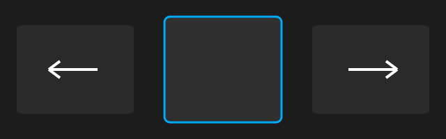

# ha-swipe-drag

**English.** Lovelace module that switches dashboard views with a finger-following swipe. Packaged as a HACS dashboard plugin (category `plugin`). Defaults match the copy that was served from `/config/www/ha-swipe-drag/ha-swipe-drag.js`: it runs only for the Home Assistant user `tab`, only when the dashboard sets `swipe_drag.enable`, and it refits thermostat and history-graph cards on the `dacha-heating` panel. `dist/ha-swipe-drag.js` is the module itself. There is no build step; `dist/` is tracked in git and is the folder HACS installs.



## Что это

Модуль переключает виды дашборда свайпом влево и вправо: экран едет за пальцем. Свайп работает поверх графиков. Слайдеры, поля ввода и открытые диалоги он не перехватывает.

Он заменяет hass-swipe-navigation.

По умолчанию модуль включается только если имя пользователя Home Assistant (`hass.user.name`) есть в списке, сейчас это `tab`, и в конфигурации дашборда включён `swipe_drag`. Подгонка карточек термостата и графиков history-graph включается только на панели `dacha-heating` и только на видах `heating`, `summary` и `boiler`.

## Установка через свой репозиторий HACS

1. HACS → ⋮ → **Custom repositories**.
2. Адрес: `https://github.com/Waitancheg/ha-swipe-drag`
3. Тип: **Dashboard**. Внутри HACS это категория `plugin`.
4. Добавить репозиторий, затем HACS → **Frontend** → HA Swipe Drag → Download.
5. Если ресурсы Lovelace хранятся в storage, HACS сам добавит ресурс. После этого обновите страницу.

Пока нет GitHub Release, HACS ставит ветку по умолчанию `main`. Для плагина это штатный способ установки. Релизы не обязательны; они нужны, чтобы выбирать версию. Ставить репозиторий имеет смысл, когда эти файлы уже в `main`.

## Ресурс

Тип ресурса: **JavaScript module** (`module`). Тип `js` не подходит: в конце файла стоит `export {}`.

HACS записывает:

`/hacsfiles/ha-swipe-drag/ha-swipe-drag.js?hacstag=…`

Файл на диске: `/config/www/community/ha-swipe-drag/ha-swipe-drag.js`. Тот же файл открывается и как `/local/community/ha-swipe-drag/ha-swipe-drag.js`.

Если ресурсы заданы в YAML, HACS их не правит. Оставьте одну запись:

```yaml
lovelace:
  resources:
    - url: /hacsfiles/ha-swipe-drag/ha-swipe-drag.js
      type: module
```

В режиме YAML параметр `?hacstag` сам не меняется. После обновления модуля смените URL, например добавьте `?v=6`, иначе планшет может оставить старый файл в кэше.

## Настройка

Объект `CONFIG` в начале `dist/ha-swipe-drag.js` задаёт значения по умолчанию:

```javascript
var CONFIG = {
  users: ["tab"],
  layoutPanel: "dacha-heating",
  layoutViews: {
    heating: "heating",
    summary: "summary",
    boiler: "boiler"
  }
};
```

Файл, который HACS кладёт в `www/community`, при обновлении перезаписывается. Для этой установки меняйте не его, а ключ `swipe_drag` в конфигурации дашборда (редактор Raw configuration), на одном уровне с `views`. Пропущенный ключ остаётся значением из `CONFIG`.

Как было на планшете, этого достаточно:

```yaml
swipe_drag:
  enable: true
```

Полный набор:

```yaml
swipe_drag:
  enable: true
  wrap: true
  users:
    - tab
  layout_panel: dacha-heating
  layout_views:
    heating: heating
    summary: summary
    boiler: boiler
```

- `enable` — без истинного значения модуль не запускается. `enable: false` его выключает.
- `wrap` — по умолчанию включён (`wrap` не задан или не `false`): с первой вкладки свайп вправо открывает последнюю, и наоборот. `wrap: false` оставляет крайние вкладки на месте.
- `users` — имена из `hass.user.name` (имя в профиле пользователя, не id). Можно передать одну строку. Пустой список не включает модуль ни для кого.
- `layout_panel` — первый сегмент пути (`/dacha-heating/...`). Раскладка карточек применяется только на этой панели.
- `layout_views` — пути видов, на которых включается конкретная раскладка: `heating` для термостатов, `summary` и `boiler` для графиков. Свайп при этом ходит по всем видимым видам дашборда, не только по этим трём.

## Миграция с `/config/www`

Старый файл лежит в `/config/www/ha-swipe-drag/ha-swipe-drag.js` и открывается как `/local/ha-swipe-drag/ha-swipe-drag.js`. Копия HACS — другой URL. Две записи в ресурсах выполняют модуль дважды: двойные точки внизу экрана и удвоенный свайп. В консоли браузера тогда две строки `[ha-swipe-drag] module loaded v6`.

Чтобы старая и новая копии не загрузились вместе:

1. Настройки → Панели управления → ⋮ → Ресурсы. Удалите ресурс `/local/ha-swipe-drag/ha-swipe-drag.js`. Если ресурсы описаны в YAML (`configuration.yaml` или файл дашборда), удалите эту запись там.
2. Удалите `/config/www/ha-swipe-drag/ha-swipe-drag.js` и пустой каталог. Иначе старый URL продолжит отдавать файл, если ресурс вернут.
3. Добавьте репозиторий в HACS и скачайте плагин.
4. Снова откройте ресурсы. Должна остаться одна запись `/hacsfiles/ha-swipe-drag/ha-swipe-drag.js`. Запись `/local/ha-swipe-drag/...` не нужна.
5. На планшете обновите страницу без кэша. В консоли одна строка `module loaded v6` и одна `listeners bound v6`. Ключ `swipe_drag` в дашборде не переносите: модуль читает его из конфигурации Lovelace, как и раньше.

## Обновление

HACS → Frontend → HA Swipe Drag → Update, затем обновить страницу планшета без кэша.

Релиз для установки не требуется. Workflow `.github/workflows/release.yml` по тегу `v*` (например `v6.0.0`) создаёт GitHub Release и прикладывает `dist/ha-swipe-drag.js`. Когда релиз есть, HACS ставит его. Число `VERSION` внутри файла — метка в логе (`v6`), это не имя тега.
